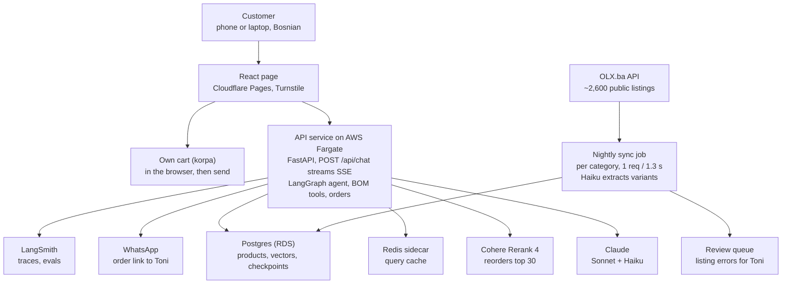
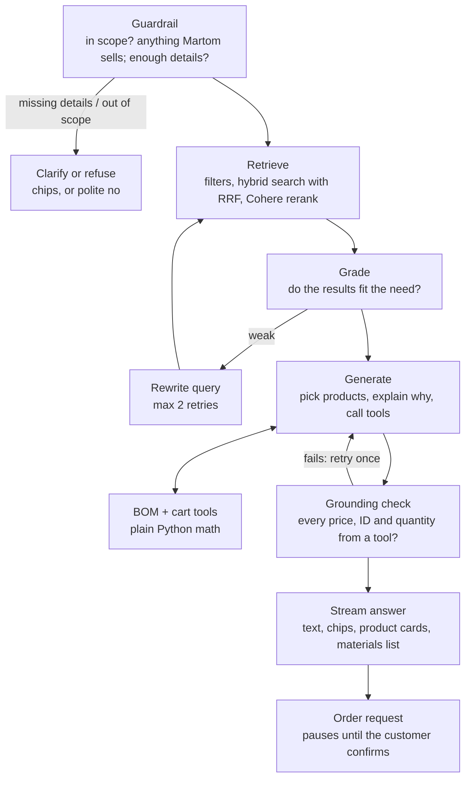

# Martom AI fence advisor — project plan

26 Nov 2026 · Tomislav Stampfel

## Goal and scope

We ship one public page where a customer describes their fence in plain Bosnian ("treba mi 25 m ograde za dvorište, 1,5 m"). An AI advisor asks what's missing, recommends the right fence system, works out every part with quantities and an estimated total, and lets the customer send the order to Martom on WhatsApp with one tap.

Fences come first, but the advisor searches the **whole Martom catalogue** (~2,600 OLX listings: tools, fittings, wire, garden, household) and answers those questions too, with product cards and links. Fences get the deep, guided flow with a materials list; everything else gets search and recommendations.

**Who it's for:** homeowners, farmers and small builders in BiH buying fences from Željezarija Martom (Čitluk / Međugorje). Many are on mobile and not technical.

**What "POC that is production-ready" means:** deep fence expertise (about 40 fence listings plus posts and accessories, with a materials list) and plain search for everything else, but real infrastructure: real data sync, tracing, evals, guardrails, rate limits and a deploy on AWS.

**In scope for v1**

- Fence advisor chat for the main fence systems: panel, welded roll mesh, knotted mesh (pletivo), chain link (baklava), PVC/animal mesh.
- Materials list (BOM): fence, posts, clamps/accessories, quantities, estimated total in KM.
- Product search across the whole catalogue for non-fence questions ("brusilica 125", "tiplo za rigips", "crijevo za vodu 25 m"): product cards with price and link, no materials list.
- Our own cart (korpa) and order request, the same workflow as martomshop.ba: the customer sends the order to Toni with one "Pošalji narudžbu" button that opens WhatsApp with a pre-filled message (Tomislav's number while testing).
- Nightly OLX sync and a review queue that flags listing errors for Toni.

**Out of scope for v1:** online payment, delivery cost calculation, Viber, the WhatsApp Business API, and any integration with the martomshop.ba cart (we use our own cart).

**Success metrics** (first 60 days live)

| Metric | Target |
| --- | --- |
| Order requests via the advisor | 10+ per month |
| Correct products in top 5 (eval set) | 90%+ |
| Correct BOM quantities (unit tests) | 100% |
| Prices in answers that came from a tool | 100% |
| Time to first token | under 2 s |
| LLM cost per conversation | under $0.10 |

## What we learned (26 Nov 2026)

The hard part is messy product data, not the AI. These are the facts the design rests on.

**martomshop.ba**

- Product IDs on the shop are the OLX listing IDs (e.g. 63996799 on both).
- Its cart is `localStorage.martomCart` with items shaped `{id, n, p, q}` and no variant field; checkout is a request form at `/ba/narudzba`; there is no online payment and Martom confirms stock and delivery by phone. We copy this workflow in our own cart; we do not integrate with it.

**OLX.ba API**

- `GET https://api.olx.ba/users/martom/listings` and `GET /listings/{id}` work **without a token**.
- It returns HTTP 429 on bursts. About 1 request every 1.3 s ran 2,500+ requests without one 429.
- Plain pagination is broken: 129 pages returned 2,585 rows but only 993 unique listings. Paging per category (`&category_id=`) returns exact totals, so the sync works per category.
- Working listing links have this format: `https://martom.olx.ba/artikal/{slug}`, where the slug already ends in the id. `olx.ba/artikal/{id}` does not open.

**Data quality** (from auditing all 39 fence listings plus titles/prices of ~2,290 listings)

- Variants (height × length × colour) and their prices exist **only in free-text descriptions**, never as structured fields.
- Errors are common: impossible sizes ("153 X 2500CM"), heights listed without a price, the same product listed twice at two prices, 28 new items marked "Korišteno", wrong material attributes ("Kovana" on wire mesh), LaTeX left in a description, 23 listings without photos, 46 "Na upit".
- Consequence: extraction must copy what it reads, and deterministic checks must flag the problems into a review queue for Toni instead of silently "fixing" them.

## Architecture

Customers only ever talk to the API service. The nightly job keeps Postgres in step with OLX and sends listing problems to Toni's review queue.

## Agent graph

The main path follows the course's Week 7 nodes. Martom adds clarifying chips, the BOM tools, the grounding check, and an order step that waits for the customer to confirm. If grounding fails twice, the customer gets plain search results instead of an answer.

## Tech stack and decisions

The design follows the jamwithai **Production Agentic RAG** course, adapted from research papers to a product catalogue.

| Area | Choice | Why |
| --- | --- | --- |
| Frontend | React + TypeScript (Vite) on Cloudflare Pages, free martom-savjetnik.pages.dev address | Tomislav's stack; free static hosting |
| Backend | Python 3.12, FastAPI, uv | Course stack; async streaming (SSE) |
| Agent | LangGraph, using LangChain components | Explicit graph: guardrail → retrieve → grade → rewrite → generate; interrupts for order confirmation |
| LLMs | Claude Sonnet 5.5 (agent), Claude Haiku 5.5 (extraction, query parsing, grading) | Strong Bosnian, good tool use; API credits now, Bedrock later |
| Search | Postgres 16: full-text (`martom` config with unaccent) + pgvector, combined with RRF | 2,600 products don't need OpenSearch; one store for products, vectors and LangGraph checkpoints |
| Rerank | Cohere Rerank 4 Fast | Multilingual; skipped automatically if it's down |
| Embeddings | Multilingual model, to be chosen in M3 (Cohere embed-multilingual or similar) | Decided with the eval set, not upfront |
| Cache | Redis (sidecar container) | Repeated queries and embeddings (course week 6) |
| Ingestion | Scheduled container task, nightly | One job doesn't need Airflow |
| Monitoring | LangSmith (tracing, datasets, evals) | Native to LangGraph |
| Orders | WhatsApp click-to-chat link (wa.me) with the order pre-filled, sent from the customer's own phone | Free, no business accounts; Toni gets orders in the app he already uses; one button keeps it simple |
| Hosting | AWS: ECS Fargate behind a load balancer, CloudFront in front (free HTTPS `*.cloudfront.net`), RDS Postgres (pgvector), Redis as a sidecar container, EventBridge Scheduler | US/AWS job focus; a real production deploy for the CV |
| Repo / CI | Public GitHub repo, GitHub Actions on `ubuntu-latest` | Standard runners are free on public repos |

**Rules that never bend**

- Prices, product IDs and quantities only ever come from tools (database or BOM calculator), never from the model.
- Every BOM calculation is plain Python with unit tests.
- Product descriptions are data, never instructions (prompt-injection safe).

## Data model

Seven Postgres tables.

| Table | Holds | Filled by |
| --- | --- | --- |
| `olx_listing` | Raw OLX listing, cleaned description, change-detection hashes, active flag | Nightly sync |
| `product` | Structured extraction (type, brand, material, colours), `search_text`, generated `tsvector`, embedding (M3) | Extraction step |
| `product_variant` | One row per height × length × colour with price and unit | Extraction step |
| `review_issue` | Data problems for Toni, in Bosnian, deduplicated by fingerprint, open/resolved/ignored | Deterministic checks |
| `knowledge_chunk` | Toni's fence know-how: how each system is built, post spacing, compatibility | By hand (M2) |
| `order_request` | Cart snapshot, customer details, status | Order node (M5) |
| `sync_run` | Each sync/extraction run with stats, for freshness alerts | Sync jobs |

**What gets indexed:** a compact `search_text` built from title, product type in Bosnian, brand, colours, heights, mesh, uses, compatibility and synonyms (stup/stub, koke/kokoši). The marketing description is not indexed, because its boilerplate drowns out the facts.

**Change detection:** a listing is re-fetched only when its summary hash changes, and re-extracted only when its detail hash changes. Listings are deactivated only when a sync covered 100% of the shop's reported total.

## Customer experience

Mobile-first, Bosnian UI, Martom's visual identity: the real "ŽELJEZARIJA MARTOM" logo, Martom red `#E30613`, a red curved hero panel and red hexagon badges (from martom.springmedia.hr), a red top strip and category tiles (Bauhaus-style), and a live "Savjetnik radi" card showing the agent's steps. Headings in Outfit, body in Inter. The customer reaches a complete materials list in about 4 taps after typing their need.

**Mockups:** `docs/mockups/` — a clickable 5-screen web flow and the same 5 screens on mobile. Live canvas: https://claude.ai/artifact/PRhcz41JRzk4dGZvuAVNJP

**Flow**

1. **Start:** logo, one large input whose placeholder types an example letter by letter, erases it, then types the next ("Treba mi 25 m ograde za dvorište, visina 1,5 m", "Ograda za kokoši, 20 metara", "Šta sve treba za panelnu ogradu?", "Brusilica 125 mm za metal"), quick-start chips (Dvorište · Kokoši i životinje · Njiva i vinograd · Balkon · Gabioni · Alat i ostalo), and an always-visible phone button for people who would rather talk to Toni.
2. **Clarify:** the advisor asks only what's missing, as tappable chips (colour, number of corners when the layout is unclear, gate yes/no, length or height if not given; base-plate posts are the default, posts for concrete only "po narudžbi"). On web, a "Vaš projekt" panel fills in as answers arrive.
3. **Recommend:** 1–3 product cards (photo, name, why it fits, variant picker for height/colour, price per unit, link to the OLX listing).
4. **Materials list:** a BOM card with every line (panels, base-plate posts, PVC clips, anchors; "po narudžbi" and gate lines show "cijena na upit"), quantities the customer can adjust, an estimated total in KM, and the note "Cijene informativne, dostava se potvrđuje". One tap adds everything to our own cart (korpa), which also takes single products found by search.
5. **Order request:** form with the same fields as martomshop.ba (ime i prezime, telefon, dostava/lično preuzimanje, adresa, napomena, consent). One button, "Pošalji narudžbu", opens WhatsApp with the order pre-filled to the owner's number; the customer only presses send.
6. **Confirmation:** "Hvala! Zahtjev je kod Martoma" with what happens next and the message that was sent.

Non-fence questions skip steps 2 and 4: the advisor goes straight to matching product cards, and the customer can still send an order request for them.

**States to design:** streaming answer, no results (offer a call), product unavailable, error/offline, rate-limited.

## Milestones and issues

Seven milestones and 33 issues. Each row is one GitHub issue and roughly one PR. Each milestone ends with something runnable. M0–M2 need no customer-facing code, so Toni's listing fixes can start early.

### M0 — Foundations

| ID | Issue | Done when |
| --- | --- | --- |
| M0-1 | Repo scaffold: uv, src layout, ruff, pytest, MIT licence, `.gitignore`, `.env.example`, README skeleton, `CLAUDE.md` | `uv run pytest` and `uv run ruff check` pass; no secrets in git |
| M0-2 | docker-compose: `pgvector/pgvector:pg16` + Redis; migration runner; migration 001 | `docker compose up` gives a healthy DB; migrations re-run safely |
| M0-3 | GitHub Actions CI: lint, tests, migrations against a Postgres service container | Green on every PR; `ubuntu-latest` only; no `pull_request_target` |
| M0-4 | FastAPI skeleton: settings (pydantic-settings), structured logging, `GET /health` (DB + Redis) | `/health` returns 200 with both checks |

### M1 — OLX ingestion (course weeks 1–2)

| ID | Issue | Done when |
| --- | --- | --- |
| M1-1 | OLX client: 1 request / 1.3 s limiter, 429/5xx backoff honouring Retry-After, timeouts | Unit tests with a fake transport prove pacing and retries |
| M1-2 | Category sync: discovery, per-category pagination, dedupe, coverage reconciliation | Test reproduces the duplicate-pagination bug; nothing deactivated below 100% coverage |
| M1-3 | Detail fetch, HTML cleanup (footer strip), summary/detail hashes | Fixture tests on real descriptions; unchanged listings are not re-fetched |
| M1-4 | Persistence (psycopg 3), `sync_run` records, CLI `martom sync` | Integration test against Postgres in CI; a full sync of ~2,600 listings finishes without 429 |

### M2 — Extraction and data quality

| ID | Issue | Done when |
| --- | --- | --- |
| M2-1 | Extraction: Pydantic schema, Haiku structured output via LangChain, retries, concurrency 4, LangSmith traces | Golden tests on 10 recorded real listings (fences and other products); runs on the whole catalogue; re-extracts only on detail-hash change |
| M2-2 | Deterministic checks into `review_issue` (sizes, missing prices, price conflicts, material, used, photos, duplicates, typos, markup) | Panel fence 63996799 fixture raises `implausible_dimension` and `height_without_price` |
| M2-3 | Toni report: CLI `martom report` + `GET /admin/review-issues` (token) | Bosnian message grouped by priority with working `martom.olx.ba/artikal/{slug}` links |
| M2-4 | Knowledge base v1: ~10 chunks with Toni (each fence system, posts, spacing, concrete vs base plate, gates) + loader | Toni has read and approved every chunk |

### M3 — Retrieval (course weeks 3–4, 6)

| ID | Issue | Done when |
| --- | --- | --- |
| M3-1 | Eval dataset: 50+ real customer questions (about 35 fence, 15 other products) with expected listing IDs, in LangSmith + repo JSONL | Exists before any tuning; Toni reviewed the answers |
| M3-2 | Keyword search: full-text + trigram + filters (type, height, colour, price) | Baseline recall@10 reported in the PR |
| M3-3 | Embeddings + pgvector migration + hybrid search with RRF | Hybrid beats keyword baseline on recall@10 |
| M3-4 | Query understanding (Haiku → filters) + Cohere Rerank 4 with fallback | recall@5 ≥ 90%; p95 retrieval < 800 ms |
| M3-5 | Redis cache for query results and embeddings (TTL, graceful fallback) | Cache hit skips LLM/embedding calls; Redis down ≠ outage |

### M4 — Agent (course weeks 5, 7)

| ID | Issue | Done when |
| --- | --- | --- |
| M4-1 | BOM calculator: panel system (panels, base-plate posts, PVC clips and anchors by height, corners, gate and "po narudžbi" lines) | Unit tests for 10 m, 25 m, corners, partial panels; rules from [`docs/domain/fence-rules.md`](domain/fence-rules.md) |
| M4-2 | BOM calculator: roll mesh, pletivo, chain link (posts every 2.5 m, tension wire, tensioners, corner braces) | Unit tests per system |
| M4-3 | LangGraph graph: guardrail (in scope = anything Martom sells), clarify, retrieve, grade, rewrite (max 2), generate + tools, grounding check; Postgres checkpointer | Graph tests with a fake LLM; every node traced in LangSmith |
| M4-4 | `POST /api/chat` SSE with typed events: token, chips, product_cards, bom, error | Event contract documented; first token < 2 s locally |
| M4-5 | Agent evals in CI: 20 scripted conversations, LLM judge for Bosnian quality and grounding | PR fails on regression |

### M5 — Frontend and orders

| ID | Issue | Done when |
| --- | --- | --- |
| M5-1 | React + TS (Vite) app, design tokens from the mockups, Bosnian copy | Matches mockups on 360 px and 1280 px |
| M5-2 | Start screen: logo, typing/erasing placeholder, quick chips, call button | Placeholder types, pauses, erases and cycles; chips start a chat |
| M5-3 | Chat: streaming, clarify chips, product cards with variant picker | Works with the M4-4 SSE contract |
| M5-4 | BOM card: editable quantities, live total, "cijene informativne" note | Quantity edits recalc via API, never in the browser alone |
| M5-5 | Our own cart (korpa, kept in the browser) + order form + confirmation; `order_request` table; resume of the LangGraph interrupt | Order stored with BOM snapshot |
| M5-6 | "Pošalji narudžbu" opens WhatsApp (wa.me link) with a pre-filled message; owner number from env | A test order from a phone arrives on Tomislav's WhatsApp, readable and complete |
| M5-7 | Abuse protection: Cloudflare Turnstile, rate limits per IP/session, token cap per conversation | Load test can't exceed the cost cap |

### M6 — Deploy and launch

| ID | Issue | Done when |
| --- | --- | --- |
| M6-1 | AWS infrastructure as code (Terraform): ECS Fargate behind an ALB with CloudFront in front (free HTTPS `*.cloudfront.net` address, SSE streaming), RDS + pgvector, Redis sidecar, EventBridge, Secrets Manager | `terraform apply` from scratch works |
| M6-2 | CD: deploy on merge to `main`, OIDC to AWS (no long-lived keys) | A merge deploys without manual steps |
| M6-3 | Monitoring: LangSmith feedback (thumbs), sync freshness alert, error alerts, cost per conversation | Alert fires when the nightly sync fails |
| M6-4 | Launch checklist + Toni handover (review queue, switching the order number to his) | Toni can read and close review issues alone |

## Evals, monitoring and security

Nothing reaches production without a measured eval, and no secret or customer data ever enters the public repo.

**Evals (in CI, on every PR that touches retrieval, prompts or the graph)**

- Retrieval: recall@5, recall@10 and MRR on the eval dataset (M3-1).
- BOM: deterministic unit tests, 100% must pass.
- Agent: 20 scripted conversations judged for correct products, correct quantities, grounding (every price from a tool) and natural Bosnian.
- Extraction: golden tests on recorded listings; a change in extraction prompt shows the diff in variants.

**Monitoring (production)**

- LangSmith traces for every conversation and extraction; thumbs up/down from customers as online feedback.
- Alerts: nightly sync failed or coverage < 100%, error rate spike, cost per conversation over budget.
- Weekly: review-queue size, order requests, top unanswered questions (feed them into the eval set).

**Security and privacy**

- Secrets only in GitHub Actions Secrets / AWS Secrets Manager; AWS access through OIDC, no long-lived keys.
- Public repo rules: no `.env`, no OLX dumps, no customer orders, no review reports, no phone numbers in code. Anything committed while public counts as public forever.
- Customer data (name, phone, address) only in RDS in an EU region, kept for 12 months, never sent to LangSmith (redacted in traces).
- Public endpoint: Turnstile, per-IP and per-session rate limits, a cap on tokens per conversation.
- Prompt injection: listing text and customer messages are data; the model cannot place orders without the customer's explicit confirmation step.

## Running costs (approximate)

Expect roughly **$45–80 per month** at launch traffic (a few hundred conversations). AWS is the biggest line; the AI parts cost little at this volume. AWS and Claude figures are estimates and need checking against current pricing in M6-1. Set an AWS Budgets alert at ~$50 on day one.

| Item | Per month | Note |
| --- | --- | --- |
| AWS: Fargate (API + nightly job, Redis as a sidecar container), load balancer, RDS Postgres small | ~$35–45 | Kept on purpose as a learning investment: ECS + load balancer + RDS + Terraform is the standard AWS pattern in job ads. ElastiCache only if traffic needs it. |
| Claude: agent (Sonnet) + extraction/grading (Haiku) | ~$10–30 | Target < $0.10 per conversation; full catalogue extraction is a one-off of a few dollars |
| Cohere Rerank 4 Fast | ~$1–2 | About $2 per 1,000 searches |
| WhatsApp orders | $0 | Click-to-chat links sent from the customer's phone; no Meta fees |
| LangSmith | $0 | Free developer tier to start; Plus is $39/seat/month if needed |
| Cloudflare (frontend, Turnstile), GitHub Actions (public repo) | $0 | Standard runners are free on public repos |

## Open questions

Roll-fence posts block M4-2 and the customer questions block M3-1. The rest can wait until their milestone.

- [x] **Toni: panel fence rules** — answered 26 Nov 2026, written up in [`docs/domain/fence-rules.md`](domain/fence-rules.md): base-plate post per panel height, PVC clips and anchors per post, corners (one post, double clips), concrete-in-soil posts only "po narudžbi" with no price. Unblocks M4-1.
- [ ] **Toni: gate sizes and prices** — gates are answered as a rule (separate product, "Kapija – cijena na upit", never a calculated price), but the data is pending. Not blocking.
- [ ] **Toni: roll-fence posts** — which post listings go with roll mesh, pletivo and chain link, and how they pair. Blocks M4-2.
- [ ] **Toni: the 905,10 KM reference example** — which panel width and line items make up the 25 m / 153 cm total in `fence-rules.md`. Needed before the M4-1 fixture is final.
- [ ] **Toni: 50 real customer questions** with the products he would sell for each (35 fence, 15 other). Blocks M3-1.
- [ ] **Toni: fix the listing errors** from the 26 Nov audit (panel 153 × 2500 cm, "Korišteno" items, wrong materials). Not blocking, but the advisor is only as good as the listings.
- [x] **Order number** — decided: orders go to Tomislav's own number while testing, set only as the `ORDER_PHONE` env var / GitHub secret, never in the repo. Switch to Toni's number at launch (M6-4).
- [x] **Domain** — decided: free addresses to start. Page on `martom-savjetnik.pages.dev` (Cloudflare Pages), API on its CloudFront default `*.cloudfront.net` address. A custom domain later is only a DNS change.
- [x] **Delivery** — decided: same as martomshop.ba. Delivery isn't in the total; the customer picks delivery or pickup, and Martom confirms the delivery price after checking stock and address ("dostava se potvrđuje").

## How the work is run

The agent team is defined in `docs/agents/` (`manager.md`, `employee.md`, `reviewer.md`) and started with the kickoff prompt (`CLAUDE_CODE_KICKOFF.md`). Tomislav runs only the manager; it starts ready issues on its own, one employee per issue in a separate git worktree (max 3 at once), has a reviewer check each branch before the PR opens (local PASS/FAIL report, at most 3 rounds), and reports when a PR is open with green CI. Only Tomislav merges.
